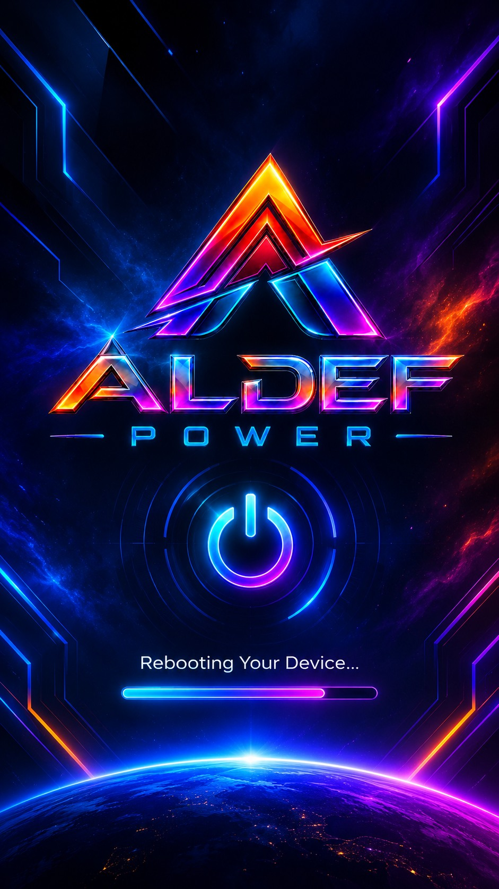

<p align="center">
  <a href="https://aldeftech.com" target="_blank">
    
  </a>
</p>

<h1 align="center">ALDEF POWER</h1>

<p align="center">
  <strong>Restart & Kunci Layar Tanpa Tombol Power — Plus Ruang Privat untuk Aplikasi dan Media.</strong>
</p>

<p align="center">
  <a href="https://aldeftech.com"></a>
  
  
  
  
</p>

<p align="center">
  
</p>

## Tentang ALDEF POWER

**ALDEF POWER** adalah aplikasi Android yang lahir dari kebutuhan sederhana: **tombol power HP rusak**, padahal HP tetap harus bisa di-restart dan dikunci layarnya setiap hari. Aplikasi ini menggantikan fungsi tombol power lewat layanan aksesibilitas resmi Android — tanpa root dan tanpa PC.

Di balik tampilannya yang sederhana, ALDEF POWER juga menyimpan **Ruang Privat**: fitur rahasia tanpa tombol untuk menyembunyikan aplikasi serta foto & video, yang hanya bisa dibuka dengan gestur ketukan khusus.

### Fitur utama

- **Restart Sekarang** — membuka menu power bawaan sistem; cukup geser ke atas untuk Restart.
- **Kunci Layar** — mematikan layar dengan aman tanpa tombol power.
- **Akses cepat** — tile *Restart HP* & *Kunci Layar* di panel notifikasi, serta shortcut ikon aplikasi.
- **Sembunyikan aplikasi** — tersinkron **dua arah** dengan fitur *Hide apps* realme; aplikasi tersembunyi tetap bisa dibuka dari Ruang Privat **tanpa unhide**.
- **Sembunyikan foto & video** — dipindahkan ke brankas tersembunyi sehingga hilang dari Galeri, lengkap dengan penampil foto & pemutar video bawaan.
- **Cari & filter** — pencarian aplikasi/media serta filter *Semua · Foto · Video*.
- **Privasi** — Ruang Privat dilindungi dari screenshot dan tidak tampil di layar Recent.
- **Tampilan premium** — tema gelap bernuansa brand Aldef, splash animasi, dan tombol bergradasi.

### Fitur Ekstra

Diatur dari **Status & Pengaturan → Fitur Ekstra**:

| Fitur | Cara kerja |
| --- | --- |
| **Ketuk Punggung HP** | Akselerometer mendeteksi ketukan di punggung HP: **2×** kunci layar · **3×** buka ALDEF POWER · **4×** buka Aldef System. Sensitivitas Rendah/Sedang/Tinggi + area uji ketukan. |
| **Bola Power Melayang** | Tombol neon yang mengambang: **ketuk** panel volume (besar/kecilkan suara) · **tahan** menu power (kunci layar, restart, power off) · **geser cepat** screenshot · **seret** untuk memindahkan. |
| **Selfie Penyusup** | Kamera depan memotret diam-diam saat **PIN layar kunci** atau **kode Ruang Privat** salah, lengkap dengan cap waktu. Foto ada di Ruang Privat → ⋮ → *Log Penyusup*. |
| **Kirim Penyusup ke Email** | Foto penyusup + tanggal, jam, perangkat & baterai **otomatis dikirim ke email** lewat SMTP Gmail (Sandi Aplikasi Google, disimpan terenkripsi Android Keystore). Saat offline, foto diantrikan dan dikirim begitu internet tersedia. |
| **Brankas Pengecoh** | Ruang Privat kini dibuka dengan **kode**. Kode asli membuka brankas sungguhan; kode pengecoh membuka brankas palsu bertampilan identik. Diatur dari Ruang Privat → ⋮ → *Brankas Pengecoh*. |
| **Animasi Cas Neon** | Animasi premium saat charger dicolok (juga di layar kunci), **tampil terus sampai diketuk**: cincin energi berputar, partikel, persentase, suhu, tegangan, perkiraan waktu penuh. |

### Remote TV

Dari halaman utama → **Remote TV**: kendalikan **Android TV / realme TV** lewat Wi-Fi dengan protokol **Android TV Remote v2** (protokol yang sama dengan aplikasi Google TV).

- TV dicari otomatis di Wi-Fi yang sama (mDNS), atau masukkan IP manual.
- Pairing sekali: kode 6 karakter muncul di layar TV, ketik di HP; berikutnya tersambung otomatis.
- **D-pad neon** atau **Touchpad** (geser = arah, ketuk = OK, tahan = tekan lama).
- Power, Input, Pengaturan, Kembali, Home, Menu, Volume ± / Bisu, Channel ±, Putar/Jeda, Mundur/Maju.
- **Keyboard ke TV**: ketik di HP lalu kirim ke kolom teks TV (mis. cari YouTube), *Kirim + Enter* untuk langsung mencari; terbuka otomatis saat TV meminta keyboard.
- **Tombol volume HP** ikut mengatur volume TV; pintasan buka **YouTube**.

### Fitur rahasia

Tidak ada tombol yang terlihat. Ketuk cepat **5×** (jeda < 0,7 detik):

| Ketuk 5× | Membuka | Fungsi |
| --- | --- | --- |
| Teks footer **ALDEF TECH** | **Sembunyikan** | Tab *Aplikasi* & *Media*, pilih lebih dari satu, lalu **Sembunyikan** |
| **Logo ALDEF** di bagian atas | **Papan kode → Ruang Privat** | Masukkan kode (asli / pengecoh). Buka item tersembunyi; tahan untuk memilih, lalu **Tampilkan Kembali** |

## Persyaratan

| Kebutuhan | Keterangan |
| --- | --- |
| Sistem operasi | Android **8.0 (API 26)** atau lebih baru |
| Perangkat | Dioptimalkan & diuji pada **realme 5 Pro (RMX1971, realme UI 2.0 / Android 11)** |
| Layanan Aksesibilitas | **Wajib** — untuk menu power, kunci layar, dan sinkron *Hide apps* |
| Akses semua file | Diperlukan untuk menyembunyikan foto & video |
| Fitur *Hide apps* realme | Diperlukan untuk menyembunyikan aplikasi (sandi privasi realme harus sudah diatur) |
| Root / PC | **Tidak diperlukan** |

> ⚠️ Di menu power realme, geser bulatan **ke ATAS** untuk Restart. **Jangan** geser ke bawah (*Power off*) — tanpa tombol power, HP akan sulit dinyalakan kembali.

## Tentang Repositori

Repositori ini berisi seluruh source code aplikasi ALDEF POWER. Aplikasi ditulis dalam **Java murni dengan framework Android** (tanpa dependensi AndroidX/pihak ketiga), sehingga ringan dan mudah dibangun ulang.

Cakupan kodenya meliputi:

- alur restart & kunci layar melalui `AccessibilityService` (`performGlobalAction`);
- splash dua tahap (hitam → gambar dengan progress bar animasi 3 detik);
- layar Sembunyikan & Ruang Privat berbasis dua tab dengan pemilihan banyak item, pencarian, dan filter;
- brankas media di `/storage/emulated/0/.aldef_vault` (dengan `.nomedia` dan `index.json`) yang tetap aman walau aplikasi di-uninstall;
- sinkronisasi dua arah dengan *Hide apps* realme melalui otomasi aksesibilitas, karena API realme dikunci izin sistem;
- dukungan opsional Mode Admin (*device owner*) dan root sebagai metode cadangan.

### Struktur kode

| File | Peran |
| --- | --- |
| `SplashActivity` | Splash hitam → gambar ALDEF POWER + loading 3 detik |
| `MainActivity` | Halaman utama: Restart, Kunci Layar, status & pengaturan, gestur rahasia |
| `RebootHelper` | Logika restart & kunci layar |
| `RebootAccessibilityService` | Menu power, kunci layar, auto-tap & mesin sinkron *Hide apps* |
| `VaultActivity` | Layar Sembunyikan & Ruang Privat (tab, cari, filter, aksi massal) |
| `AppHider`, `RealmePrivacy`, `RealmeSync` | Daftar aplikasi tersembunyi & jembatan ke *Hide apps* realme |
| `MediaVault`, `ThumbLoader`, `MediaViewerActivity` | Brankas foto/video, thumbnail, dan penampil media |
| `RestartTileService`, `LockTileService`, `QuickActionActivity` | Tile panel notifikasi & shortcut |
| `IntruderMailer`, `SmtpMailer`, `IntruderMailJob`, `SecretBox` | Kirim Selfie Penyusup ke email (SMTP Gmail, antrean offline, sandi terenkripsi) |
| `RemoteActivity`, `TvRemote`, `TvPairing`, `TvCert`, `TvDiscovery`, `Proto` | Remote Android TV v2: pairing, TLS + protobuf, sertifikat klien, pencarian mDNS |
| `DpadView`, `TouchpadView` | D-pad neon & touchpad remote TV |

## Teknologi

| Area | Teknologi |
| --- | --- |
| Bahasa | Java 17 |
| Platform | Android SDK 35 (min SDK 26) |
| UI | Android Framework Views, Material (framework theme), Vector Drawable |
| Build | Gradle 8.13, Android Gradle Plugin 8.10.1 |
| API utama | AccessibilityService, MediaStore, TileService, DevicePolicyManager (opsional) |

## Instalasi

### Pasang APK

1. Build APK (lihat di bawah) lalu salin ke HP, atau pasang lewat PC: `adb install -r app-debug.apk`.
2. Buka **ALDEF POWER** → ketuk **Aksesibilitas** → aktifkan **ALDEF POWER**.
3. Agar tidak dimatikan sistem realme: **Baterai & Latar Belakang** → izinkan aktivitas latar belakang, lalu kunci aplikasi di menu Recent.
4. (Opsional) Tambahkan tile **Restart HP** & **Kunci Layar** di panel notifikasi.

### Build dari source

```bash
git clone https://github.com/aldef-deni/aldef-power.git
cd aldef-power
./gradlew assembleDebug        # Windows: gradlew.bat assembleDebug
```

Hasil build: `app/build/outputs/apk/debug/app-debug.apk`

> Pastikan JDK 17+ dan Android SDK (platform 35) sudah terpasang, serta `local.properties` berisi `sdk.dir` yang sesuai.

## Izin yang Digunakan

| Izin | Kegunaan |
| --- | --- |
| `BIND_ACCESSIBILITY_SERVICE` | Menu power, kunci layar, sinkron *Hide apps* realme |
| `MANAGE_EXTERNAL_STORAGE` | Memindahkan foto & video ke brankas tersembunyi |
| `QUERY_ALL_PACKAGES` | Menampilkan daftar aplikasi yang bisa disembunyikan |
| `BIND_QUICK_SETTINGS_TILE` | Tile Restart & Kunci Layar |
| `BIND_DEVICE_ADMIN` | Mode Admin opsional & pantau PIN salah (Selfie Penyusup) |
| `CAMERA` | Selfie Penyusup |
| `INTERNET`, `ACCESS_NETWORK_STATE` | Kirim foto penyusup ke email & Remote TV lewat Wi-Fi |

Layanan aksesibilitas hanya membaca isi layar sesaat ketika pengguna memulai sinkron *Hide apps* dari ALDEF POWER. Data hanya keluar dari HP untuk dua hal yang diaktifkan pengguna: email Selfie Penyusup (langsung ke server Gmail) dan perintah remote ke TV di jaringan lokal.

## Kustomisasi

<p align="center">
  <strong>JIKA BERMINAT UNTUK KUSTOMISASI BISA MENGHUBUNGI DENI AFRIZAL</strong>
</p>

<p align="center">
  <a href="https://wa.me/628128968609" target="_blank">
    
  </a>
</p>

## Kontak

Punya kebutuhan aplikasi Android, sistem, SaaS, integrasi, atau otomasi AI? Kunjungi [aldeftech.com/contact](https://aldeftech.com/contact) untuk mendiskusikan kebutuhan Anda bersama Aldef Tech.

---

<p align="center">
  © Aldef Tech. Seluruh hak cipta dilindungi.
</p>
